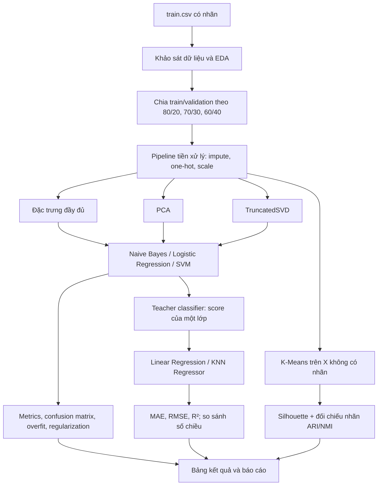

# Kiến trúc hệ thống — Phân loại mức độ béo phì

**Tài liệu:** `SYSTEM_ARCHITECTURE.md`  
**Phiên bản:** 1.0  
**Cập nhật:** 16/11/2026  
**Tên dự án:** `obesity-level-classification`  
**Đề tài:** Phân loại mức độ béo phì dựa trên đặc điểm thể chất và thói quen sinh hoạt  
**Thành viên:** linhtalinhtinh26; doonipon

## 1. Tổng quan và phạm vi

Dự án xây dựng hệ thống thực nghiệm học máy trên dữ liệu dạng bảng để dự đoán nhãn `NObeyesdad` gồm 7 mức độ cân nặng. Các mục tiêu:

1. Khảo sát, thống kê, làm sạch, mã hóa và chuẩn hóa dữ liệu.
2. Phân tích và trực quan hóa dữ liệu bằng **PCA** và **TruncatedSVD**.
3. Phân cụm bằng **K-Means**, đối chiếu đặc điểm cụm với nhãn đã biết.
4. So sánh ba mô hình phân loại thuộc ba nhóm phương pháp: **Naive Bayes**, **Logistic Regression**, **SVM**.
5. Xây dựng và so sánh hai mô hình hồi quy để xấp xỉ **score của một lớp** từ mô hình phân loại đã huấn luyện.
6. Đánh giá ảnh hưởng của tỷ lệ chia dữ liệu, giảm chiều và điều chỉnh tham số; cung cấp mã nguồn và hướng dẫn tái lập thực nghiệm.

Phạm vi sản phẩm là **mã Python, notebook, kết quả thực nghiệm, báo cáo và slide**. Không phát triển website/API/cơ sở dữ liệu phục vụ ứng dụng. Kết quả chỉ phục vụ mục đích học thuật; dữ liệu tổng hợp không được sử dụng làm công cụ chẩn đoán.

## 2. Dữ liệu

- **Nguồn:** Kaggle, Playground Series — Season 4 Episode 2 (2024): https://www.kaggle.com/competitions/playground-series-s4e2/data
- **Tệp sử dụng:** `train.csv` có nhãn; `test.csv` của cuộc thi không có nhãn, không dùng để tính độ chính xác thực nghiệm.
- **Quy mô dự kiến:** 20.758 bản ghi huấn luyện; 16 thuộc tính đầu vào kết hợp dữ liệu số và phân loại, cùng một cột `id` và cột mục tiêu `NObeyesdad`. Các thống kê sẽ được xác nhận trực tiếp từ tệp sau tải.
- **Nhãn mục tiêu:** 7 nhóm: `Insufficient_Weight`, `Normal_Weight`, `Overweight_Level_I`, `Overweight_Level_II`, `Obesity_Type_I`, `Obesity_Type_II`, `Obesity_Type_III`.
- **Nguyên tắc lưu trữ:** Không đưa CSV gốc lên repository. Cung cấp liên kết nguồn và chỉ dẫn tải về trong `data/README.md`.

`id` là định danh bản ghi, không sử dụng làm đặc trưng dự đoán. Khi phân tích dữ liệu, ghi nhận mức độ mất cân bằng lớp, bản ghi trùng và khả năng đặc trưng `Weight`/`Height` liên quan mạnh đến nhãn; tránh diễn giải tương quan như quan hệ nhân quả.

## 3. Luồng xử lý tổng thể



Đường đi của các thí nghiệm được triển khai tách biệt khi cần thiết: giảm chiều cho trực quan hóa toàn bộ dữ liệu chỉ mang tính khám phá; **mọi kết quả đánh giá mô hình** phải fit tất cả bước học tham số trên phần train của từng kịch bản.

## 4. Thiết kế thành phần

| Thành phần | Chức năng | Đầu ra chính |
|---|---|---|
| Nạp và kiểm tra dữ liệu | Đọc CSV, xác minh schema, kiểu, nhãn, trùng lặp, giá trị bất thường | Bảng chất lượng dữ liệu |
| EDA | Thống kê theo thuộc tính, phân bố 7 lớp, quan hệ đặc trưng–nhãn | Bảng, biểu đồ và nhận xét |
| Tiền xử lý | Tách `X/y`, xử lý khuyết, mã hóa categorical, chuẩn hóa numeric | Pipeline có thể fit/transform |
| Giảm chiều | PCA và TruncatedSVD; biểu diễn 4–6 thành phần, so sánh explained variance | Bảng thông tin giữ lại, đồ thị 2D |
| Phân cụm | K-Means trên đặc trưng không có nhãn, thử nhiều `k` | Chỉ số cụm, hình phân bố cụm |
| Phân loại | Naive Bayes, Logistic Regression, SVM với 3 tỷ lệ chia và 3 biểu diễn dữ liệu | Bảng metrics, ma trận nhầm lẫn |
| Hồi quy score | Xây dựng score mục tiêu của một lớp và fit hai regressor | MAE/RMSE/R² và biểu đồ sai số |
| Tổng hợp | Cố định cấu hình, seed, phiên bản thư viện; xuất kết quả | Các bảng/hình phục vụ báo cáo |

## 5. Quy tắc thiết kế thực nghiệm

### 5.1. Chia dữ liệu và tránh rò rỉ

- Dùng `train_test_split` với tỷ lệ **80/20, 70/30, 60/40**, `stratify=y`, `random_state=42` đối với phân loại.
- Đảm bảo các mô hình trong cùng một tỷ lệ dùng **cùng chỉ số mẫu train/validation**.
- Dùng `ColumnTransformer`/`Pipeline`; `SimpleImputer`, `OneHotEncoder`, `StandardScaler` và các bộ giảm chiều **fit trên train**, rồi mới transform validation.
- Điều chỉnh siêu tham số bằng cross-validation **bên trong phần train** hoặc tập tuning riêng; không liên tục chọn cấu hình trên validation rồi gọi đó là đánh giá độc lập.
- Kiểm tra trùng lặp giữa hai phần dữ liệu, nếu có, và ghi lại cách xử lý. Không đưa cột `id` hoặc `NObeyesdad` vào `X`.

### 5.2. Giảm chiều và trực quan hóa

- **PCA**: giảm chiều bằng tổ hợp tuyến tính với bước trừ trung bình; phân tích explained variance ratio và phương sai cộng dồn.
- **TruncatedSVD**: giảm chiều không yêu cầu trừ trung bình, thích hợp cả với ma trận thưa sau one-hot; có thể xuất explained variance ratio, nhưng không được diễn giải hai phương pháp là tương đương.
- Thử 4–6 thành phần đầu, trực quan các cặp `1–2`, `3–4`, `5–6` khi khả thi; dùng nhãn để tô màu **chỉ khi hiển thị/đối chiếu**, không dùng nhãn để fit PCA/SVD.
- Với so sánh phân loại/hồi quy score: dùng cấu hình dữ liệu đầy đủ và giảm về **xấp xỉ 1/3 số chiều sau mã hóa** khi số chiều cho phép. Ghi rõ số chiều thực tế, tỷ lệ phương sai và chi phí tính toán.

### 5.3. Phân cụm

- Thực hiện **K-Means** trên đặc trưng đã xử lý, **không sử dụng nhãn** để học cụm.
- So sánh các giá trị `k` phù hợp; đánh giá tối thiểu bằng **silhouette score** và một chỉ số đối chiếu nhãn như **ARI/NMI**; có thể thống kê phân bố 7 lớp trong mỗi cụm.
- Trực quan hóa cụm trong không gian 2D đã giảm chiều, đồng thời đối chiếu phân bố nhãn thật; không mặc định số cụm phải bằng 7 hoặc cụm trùng lớp.

### 5.4. Phân loại

| Nhóm phương pháp | Mô hình | Chỉ tiêu |
|---|---|---|
| Nhóm 1 | Naive Bayes (chọn biến thể phù hợp sau mã hóa) | Accuracy, macro-F1, weighted-F1 |
| Nhóm 2 | Logistic Regression đa lớp | Accuracy, macro-F1, weighted-F1 |
| Nhóm 3 | SVM (linear; RBF nếu tài nguyên cho phép) | Accuracy, macro-F1, weighted-F1 |

- Ma trận thí nghiệm tối thiểu: **3 mô hình × 3 tỷ lệ chia × 3 biểu diễn** (`full`, `PCA`, `SVD`) = **27 cấu hình**.
- Ghi train/validation metrics, confusion matrix, thời gian fit và tham số quan trọng. Phân tích nhầm lẫn theo từng nhãn.
- Kiểm tra overfitting qua chênh lệch train–validation; thử hiệu chỉnh `C` của Logistic Regression/SVM và ghi rõ tiêu chí chọn.
- Naive Bayes cần chọn biến thể có giả định thích hợp với đặc trưng đầu vào; nếu dùng GaussianNB trên dữ liệu one-hot, giải thích hạn chế.
- SVM có thể tốn tài nguyên trên 20 nghìn mẫu; kiểm thử cấu hình nhỏ trước, sau đó chạy cấu hình đã chọn và công bố điều kiện thực nghiệm.

### 5.5. Hồi quy score từ một lớp phân loại

**Định nghĩa:** Chọn một lớp cố định và một mô hình phân loại nhóm 2 hoặc 3 (ví dụ Logistic Regression) để tạo **decision score/đầu ra liên tục** cho lớp đó. Hai mô hình **Linear Regression** và **KNN Regressor** được dùng để xấp xỉ score từ đặc trưng đầu vào. Đây là bài toán mô phỏng score của classifier, **không phải dự đoán BMI hoặc một đại lượng sức khỏe**.

**Giao thức tối thiểu:**

1. Với mỗi kịch bản chia dữ liệu, fit bộ tiền xử lý và mô hình phân loại nguồn (*teacher*) **chỉ trên train**.
2. Giữ cố định teacher; lấy score của lớp đã chọn trên train và validation bằng đúng teacher và preprocessing đã fit. Không sử dụng nhãn validation để huấn luyện teacher.
3. Fit regressor trên cặp `X_train → teacher_score_train`; kiểm tra trên `X_validation → teacher_score_validation`, sử dụng MAE, RMSE, R² và biểu đồ `predicted vs. teacher score`.
4. So sánh đặc trưng đầy đủ và đặc trưng đã giảm về gần 1/3 số chiều; chỉ fit bộ giảm chiều từ train.
5. Trong báo cáo, nêu rõ bài toán **xấp xỉ hàm của teacher** có mục tiêu do mô hình sinh ra, không phải nhãn độc lập; điều này giới hạn ý nghĩa của độ chính xác hồi quy. Có thể bổ sung score trên tập ngoài hoặc score out-of-fold nếu cần đánh giá nghiêm ngặt hơn.

Cần thống nhất với giảng viên nếu yêu cầu cụ thể về định nghĩa score hoặc cách chuyển đổi phân loại sang hồi quy khác với giao thức này.

## 6. Cấu trúc thư mục

```text
obesity-level-classification/
├── README.md
├── SYSTEM_ARCHITECTURE.md
├── PLAN_14_DAYS.md
├── requirements.txt
├── .gitignore
├── data/
│   └── README.md
├── notebooks/
│   ├── 01_eda.ipynb
│   ├── 02_preprocessing_reduction.ipynb
│   ├── 03_classification.ipynb
│   ├── 04_clustering.ipynb
│   └── 05_score_regression.ipynb
├── src/
│   ├── data_loader.py
│   ├── preprocessing.py
│   ├── dimensionality_reduction.py
│   ├── classification.py
│   ├── clustering.py
│   ├── regression_score.py
│   └── evaluation.py
├── outputs/
│   ├── figures/
│   └── tables/
├── reports/
│   └── report.pdf
└── slides/
    └── presentation.pptx
```

**Nguyên tắc:** Notebook dùng để trình bày thí nghiệm; hàm tái sử dụng đặt trong `src/`. Không commit dữ liệu gốc, mô hình dung lượng lớn, file tạm, thông tin đăng nhập hoặc token. File kết quả được đặt tên đủ mô tả cấu hình và có thể tái tạo.

## 7. Công nghệ và khả năng tái lập

- Python 3.11; `numpy`, `pandas`, `scikit-learn`, `matplotlib`, `seaborn`, `jupyter`, `joblib`.
- Git/GitHub quản lý mã nguồn và công việc; các phiên bản dependency được cố định trong `requirements.txt` khi kiểm thử cuối.
- Cố định `random_state=42`, ghi seed, tỷ lệ chia, biến thể mô hình, tham số, số chiều, phiên bản thư viện và thời gian chạy.
- `README.md` mô tả quy trình tạo môi trường, tải dữ liệu, chạy notebook/scripts và cách tái tạo bảng kết quả.

## 8. Phân công công việc

| Hạng mục | Thực hiện | Phối hợp/kiểm tra |
|---|---|---|
| Khởi tạo cấu trúc repository và theo dõi Issues | linhtalinhtinh26 | doonipon |
| Kiểm tra dữ liệu, EDA, pipeline tiền xử lý | doonipon | linhtalinhtinh26 |
| PCA, TruncatedSVD, đồ thị giảm chiều | linhtalinhtinh26 | doonipon |
| Naive Bayes | linhtalinhtinh26 | doonipon |
| Logistic Regression và SVM | doonipon | linhtalinhtinh26 |
| K-Means và trực quan cụm | linhtalinhtinh26 | doonipon |
| Thiết kế teacher score, Linear Regression | doonipon | linhtalinhtinh26 |
| KNN Regressor, so sánh hồi quy score | linhtalinhtinh26 | doonipon |
| Tổng hợp kết quả, viết báo cáo và slide | Cả hai | Cả hai |
| Kiểm thử tái lập và chuẩn bị trình bày | Cả hai | Cả hai |

## 9. Sản phẩm bàn giao và tiêu chí hoàn thành

- [ ] Mã nguồn, notebook, `requirements.txt`, `README.md` và `data/README.md` chạy lại được từ dữ liệu công khai.
- [ ] Thống kê và mô tả đầy đủ dữ liệu; biểu đồ EDA có chú thích; xác minh 16 đặc trưng, số mẫu, 7 lớp.
- [ ] Tiền xử lý, chuẩn hóa, mã hóa có kiểm soát leakage.
- [ ] PCA và TruncatedSVD: 4–6 thành phần để trực quan, phương sai giải thích và so sánh kết quả.
- [ ] K-Means với lựa chọn `k`, chỉ số định lượng, biểu đồ cụm và đối chiếu nhãn.
- [ ] Ba classifier từ ba nhóm; ba tỷ lệ chia; dữ liệu đầy đủ, PCA, SVD; đánh giá overfit/regularization.
- [ ] Hai regressor cho score một lớp; dữ liệu đầy đủ và giảm còn khoảng 1/3 chiều; 3 tỷ lệ chia; MAE/RMSE/R².
- [ ] Báo cáo **15–20 trang A4, Times New Roman 13, căn đều, giãn dòng 1.3–1.5**, có phần lý thuyết, dữ liệu, thực nghiệm, so sánh, kết luận, tài liệu tham khảo.
- [ ] Slide trình bày, bảng/hình kết quả và thông tin cần thiết để tái lập.

## 10. Rủi ro và hướng xử lý

| Rủi ro | Biện pháp |
|---|---|
| Rò rỉ thông tin giữa train/validation | Pipeline fit theo từng split; kiểm tra cột bị loại |
| Dữ liệu gần như được suy ra từ cân nặng/chiều cao | Phân tích thiên lệch/khả năng học shortcut; không kết luận nhân quả |
| TruncatedSVD/PCA khác điều kiện tiền xử lý | Ghi chính xác pipeline và số chiều; không so sánh thiếu điều kiện |
| SVM chạy lâu | Kiểm thử nhỏ, đo thời gian, ưu tiên tuyến tính trước |
| Bài toán score khó diễn giải | Định nghĩa rõ teacher–student, tập fit và ý nghĩa của metric |
| Kết quả không tái lập | Ghi seed, dependency và lệnh chạy; kiểm thử ở môi trường sạch |